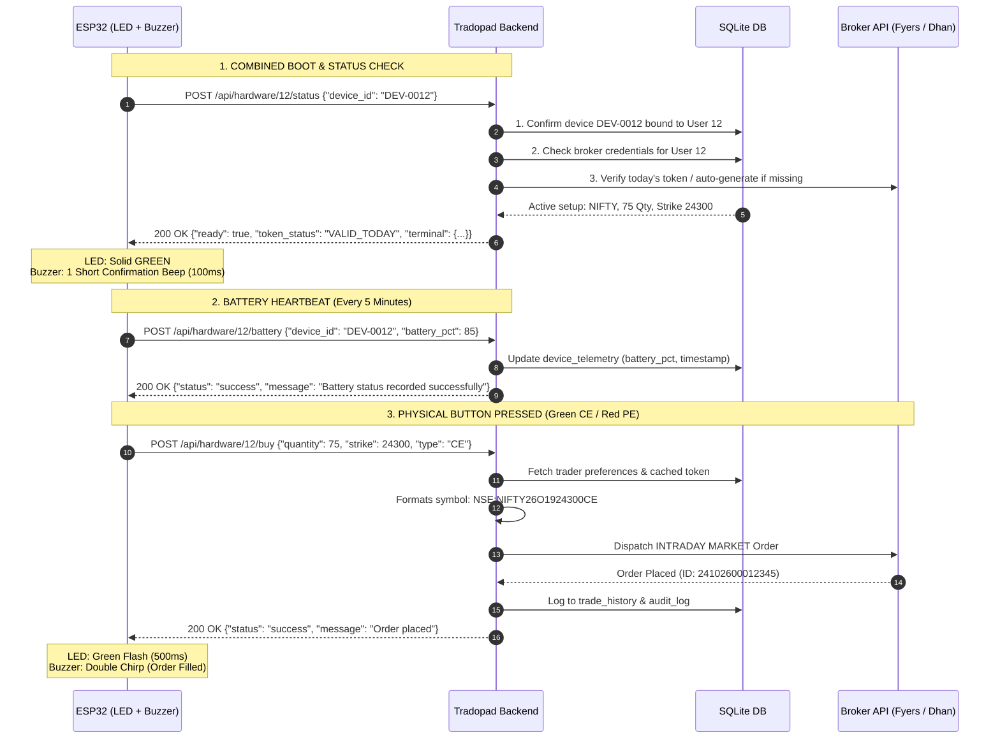

# Tradopad Hardware Console (ESP32) — Pure LED & Buzzer Specification

Specification strictly for **RGB LED** and **Piezo Buzzer** feedback.

Includes:
1. **Boot, Token Warmup & Status Check** (`POST /api/hardware/:userId/status`)
2. **5-Minute Battery Heartbeat** (`POST /api/hardware/:userId/battery`)
3. **Order Placement** (`POST /api/hardware/:userId/buy` & `POST /api/hardware/:userId/sell`)

---

## 1. Sequence Flow



---

## 2. Reference Arduino C++ Code (`tradopad_esp32_firmware.ino`)

```cpp
#include <WiFi.h>
#include <HTTPClient.h>
#include <ArduinoJson.h>

// -------------------------------------------------------------
// CONFIGURATION CONSTANTS
// -------------------------------------------------------------
const char* WIFI_SSID     = "YOUR_WIFI_SSID";
const char* WIFI_PASSWORD = "YOUR_WIFI_PASSWORD";

// Server URL & Identifiers
const char* API_BASE_URL  = "http://192.168.1.100:3000"; // Or https://api.tradopad.infirow.in
const int   USER_ID       = 12;
const char* DEVICE_ID     = "DEV-0012";

// Hardware Pins (Adjust to your board pinout)
#define PIN_BTN_CE        18   // Green Button (Buy Call)
#define PIN_BTN_PE        19   // Red Button (Buy Put)
#define PIN_LED_RED       25   // RGB Red Channel
#define PIN_LED_GREEN     26   // RGB Green Channel
#define PIN_LED_BLUE      27   // RGB Blue Channel
#define PIN_BUZZER        32   // Piezo Buzzer Pin
#define PIN_BATTERY_ADC   34   // Battery voltage divider analog pin (Optional)

// State Variables
bool isReady = false;
int activeStrike = 24300;
int activeQty = 75;

// Timers
unsigned long lastStatusPoll = 0;
const unsigned long POLL_INTERVAL_MS = 30000; // Poll status every 30s

unsigned long lastBatteryReport = 0;
const unsigned long BATTERY_INTERVAL_MS = 5 * 60 * 1000; // Report battery every 5 mins

unsigned long lastButtonPress = 0;
const unsigned long DEBOUNCE_MS = 600;

// -------------------------------------------------------------
// HARDWARE FEEDBACK HELPERS
// -------------------------------------------------------------
void setLED(bool r, bool g, bool b) {
  digitalWrite(PIN_LED_RED, r ? HIGH : LOW);
  digitalWrite(PIN_LED_GREEN, g ? HIGH : LOW);
  digitalWrite(PIN_LED_BLUE, b ? HIGH : LOW);
}

void beep(int freqHz, int durationMs) {
  tone(PIN_BUZZER, freqHz, durationMs);
}

// Simple battery percentage calculator (adjust to your voltage divider)
int readBatteryPercentage() {
  int raw = analogRead(PIN_BATTERY_ADC);
  // Example for 3.7V LiPo: 4.2V = 100%, 3.3V = 0%
  // Replace with your hardware calculation or return 85 as placeholder
  return 85; 
}

// -------------------------------------------------------------
// BATTERY HEARTBEAT (EVERY 5 MINUTES)
// -------------------------------------------------------------
void sendBatteryHeartbeat() {
  if (WiFi.status() != WL_CONNECTED) return;

  HTTPClient http;
  String url = String(API_BASE_URL) + "/api/hardware/" + String(USER_ID) + "/battery";
  http.begin(url);
  http.addHeader("Content-Type", "application/json");

  int batteryPct = readBatteryPercentage();

  StaticJsonDocument<128> reqDoc;
  reqDoc["device_id"] = DEVICE_ID;
  reqDoc["battery_pct"] = batteryPct;
  reqDoc["wifi_rssi"] = WiFi.RSSI();

  String reqBody;
  serializeJson(reqDoc, reqBody);

  http.POST(reqBody);
  http.end();
}

// -------------------------------------------------------------
// COMBINED BOOT, TOKEN WARMUP & STATUS CHECK
// -------------------------------------------------------------
bool checkReadiness() {
  if (WiFi.status() != WL_CONNECTED) {
    setLED(true, false, false); // Red
    return false;
  }

  HTTPClient http;
  String url = String(API_BASE_URL) + "/api/hardware/" + String(USER_ID) + "/status";
  http.begin(url);
  http.addHeader("Content-Type", "application/json");

  StaticJsonDocument<128> reqDoc;
  reqDoc["device_id"] = DEVICE_ID;
  String reqBody;
  serializeJson(reqDoc, reqBody);

  int httpCode = http.POST(reqBody);

  if (httpCode == 200) {
    String response = http.getString();
    DynamicJsonDocument doc(1024);
    deserializeJson(doc, response);

    bool ready = doc["ready"] | false;

    if (ready) {
      isReady = true;
      setLED(false, true, false); // Solid Green
      beep(2000, 100);            // 1 Short Ready Beep

      activeStrike = doc["terminal"]["strike"] | 24300;
      activeQty = doc["terminal"]["quantity"] | 75;
    } else {
      isReady = false;
      setLED(true, false, false); // Solid Red (Not Ready)
      beep(500, 300);             // Error Buzz
    }
    http.end();
    return ready;
  } else {
    isReady = false;
    setLED(true, false, false); // Red
    http.end();
    return false;
  }
}

// -------------------------------------------------------------
// ORDER EXECUTION (/api/hardware/:userId/buy & sell)
// -------------------------------------------------------------
void placeOrder(const char* side) {
  if (!isReady) {
    beep(400, 300); // Low error buzz
    delay(500);
    checkReadiness();
    return;
  }

  // White LED during transmission
  setLED(true, true, true);

  HTTPClient http;
  String endpoint = (strcmp(side, "CE") == 0) ? "/buy" : "/sell";
  String url = String(API_BASE_URL) + "/api/hardware/" + String(USER_ID) + endpoint;

  http.begin(url);
  http.addHeader("Content-Type", "application/json");

  // Send payload
  StaticJsonDocument<256> reqDoc;
  reqDoc["quantity"] = activeQty;
  reqDoc["strike"] = activeStrike;
  reqDoc["type"] = side; // "CE" or "PE"
  String reqBody;
  serializeJson(reqDoc, reqBody);

  int httpCode = http.POST(reqBody);

  if (httpCode == 200) {
    // SUCCESS: Green Flash + Double Chirp
    setLED(false, true, false);
    beep(2000, 60);
    delay(80);
    beep(2400, 60);
    delay(800);
  } else {
    // ERROR: Red Flash + Low Buzz
    setLED(true, false, false);
    beep(350, 400);
    delay(800);
  }

  http.end();
  checkReadiness(); // Refresh LED state
}

// -------------------------------------------------------------
// ARDUINO SETUP
// -------------------------------------------------------------
void setup() {
  Serial.begin(115200);

  pinMode(PIN_BTN_CE, INPUT_PULLUP);
  pinMode(PIN_BTN_PE, INPUT_PULLUP);
  pinMode(PIN_LED_RED, OUTPUT);
  pinMode(PIN_LED_GREEN, OUTPUT);
  pinMode(PIN_LED_BLUE, OUTPUT);
  pinMode(PIN_BUZZER, OUTPUT);

  // Self-test LED & Buzzer on boot
  setLED(true, true, true);
  beep(1800, 100);
  delay(300);
  setLED(false, false, false);

  // Connect WiFi
  WiFi.begin(WIFI_SSID, WIFI_PASSWORD);
  int attempts = 0;
  while (WiFi.status() != WL_CONNECTED && attempts < 20) {
    delay(500);
    attempts++;
  }

  if (WiFi.status() == WL_CONNECTED) {
    checkReadiness();
    sendBatteryHeartbeat(); // First battery report on boot
  } else {
    setLED(true, false, false); // Red: WiFi fail
  }
}

// -------------------------------------------------------------
// ARDUINO MAIN LOOP
// -------------------------------------------------------------
void loop() {
  unsigned long now = millis();

  // 1. Background health poll every 30 seconds
  if (now - lastStatusPoll >= POLL_INTERVAL_MS) {
    lastStatusPoll = now;
    checkReadiness();
  }

  // 2. Battery status report every 5 minutes
  if (now - lastBatteryReport >= BATTERY_INTERVAL_MS) {
    lastBatteryReport = now;
    sendBatteryHeartbeat();
  }

  // 3. Button debouncing & order placement
  if (now - lastButtonPress >= DEBOUNCE_MS) {
    // Green Button: CE
    if (digitalRead(PIN_BTN_CE) == LOW) {
      lastButtonPress = now;
      placeOrder("CE");
    }
    // Red Button: PE
    else if (digitalRead(PIN_BTN_PE) == LOW) {
      lastButtonPress = now;
      placeOrder("PE");
    }
  }

  delay(20);
}
```
